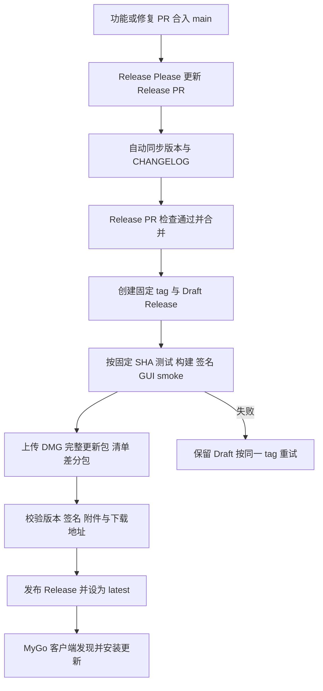

# Pic Piper 版本号管理与自动更新方案

日期：2026-11-14。状态：供审阅的设计方案，尚未实施。

目标：继续只依赖 GitHub，自动计算版本、同步版本文件、生成更新说明、构建签名、分发安装包，并由 MyGo 完成应用内更新。默认采用“合并 Release PR 时发布”的节奏；版本计算和发布执行全部自动化，维护者只决定何时把积累的变更交付用户。

## 1. 推荐组合与当前基线

采用 **SemVer + Conventional Commits + Release Please + GitHub Actions + GitHub Releases + MyGo Updater**。

Release Please 管理版本提案；Actions 负责构建和发布；MyGo 负责客户端下载、验签和替换应用。直接使用 MyGo 的清单与更新源，首版不增加 Pages、自定义 stable.json 或另一套更新框架。[Release Please](https://github.com/googleapis/release-please-action)；[MyGo 更新机制](https://github.com/egoist/mygo/blob/v0.9.0/docs/updates.md)

核查现状：

- 公开的 [v1.0.0 Release](https://github.com/frankwei98/PicPiper/releases/tag/v1.0.0) 已存在，包含 macOS arm64 DMG；本地同名 tag 为 `d3edcb07b7bb1cb2978a95924fdc8703ee4d8d9a`。从 1.0.0 接续，保留历史版本。
- [package.json](../package.json) 与 [mygo.json](../mygo.json) 都是 1.0.0；框架、CLI 和前端 runtime 均固定 0.9.0。
- [当前工作流](../.github/workflows/release.yml) 支持 main、PR、v* tag 和手动触发，但版本号仍需人工修改，只上传 DMG，尚无更新清单。
- 应用尚未启用 MyGo Updater。旧 Tauri 发布与当前 MyGo 包不共用自动升级链；当前 1.0.0 用户须手动安装一次首个启用更新的版本。

## 2. 版本规则：人描述变更，机器计算号码

采用 `MAJOR.MINOR.PATCH`；同一批提交按最高变更级别升级一次，不按提交数量累加。[SemVer](https://semver.org/lang/zh-CN/)；[Release Please 默认版本策略](https://github.com/googleapis/release-please/blob/v17.3.0/src/versioning-strategies/default.ts)

| 合入 main 的变更 | 本项目约定 | 以 1.2.3 为例 |
| --- | --- | --- |
| 修复问题、需要交付的性能或依赖修复 | `fix: …`、`fix(perf): …`、`fix(deps): …` | 1.2.4 |
| 向用户增加兼容的新能力 | `feat: …` | 1.3.0 |
| 破坏兼容性 | `feat!: …`、`fix!: …`，或规范的 `BREAKING CHANGE:` | 2.0.0 |
| 仅文档、测试、内部整理、CI 维护 | `docs:`、`test:`、`refactor:`、`ci:`、`chore:`，无破坏性标记 | 按配置不单独触发正式版 |

桌面应用的兼容性重点是已有配置、命名模板、数据与用户依赖的行为；内部模块重构不应仅因代码变化大就标记 major。需要发给用户的修复要使用 `fix`，避免被归入纯维护变更。工具不能自行判断业务语义，PR 标题是维护者给自动化的输入。

建议普通 PR 使用 squash merge，以 PR 标题作为合并提交标题，CI 校验 Conventional Commit 格式；破坏性变更显式保留 `!`。配置明确隐藏纯维护类的 changelog 项，特殊情况通过 Release Please 的版本覆盖机制留痕，而非手改 tag。[提交与版本规则](https://github.com/googleapis/release-please#how-should-i-write-my-commits)；[定制规则](https://github.com/googleapis/release-please/blob/v17.3.0/docs/customizing.md)

例如，1.0.0 以后合并 3 个 fix 和 1 个 feat，机器人维护一个 1.1.0 Release PR；继续合并 fix 时仍更新这个 PR，不生成 1.1.1。首次增加自动更新属于 feat，若期间无破坏性变更，预期首个接入版本为 1.1.0。

## 3. 版本只计算一次，各处自动同步

| 位置 | 职责 | 维护方式 |
| --- | --- | --- |
| `package.json.version` | 仓库中应用版本的主字段 | Release Please 的 node 策略更新 |
| `mygo.json.version` | MyGo 构建输入 | 同一个 Release PR 通过 extra-files JSON 更新 |
| `.release-please-manifest.json` | Release Please 的版本跟踪状态 | 由工具维护，初始化根项目为 1.0.0；它不代表该版本一定已公开发布 |
| `CHANGELOG.md` | 按版本组织的更新说明 | Release PR 自动生成，维护者可审阅措辞 |
| `vX.Y.Z` tag | 绑定具体源码提交 | 自动创建，创建后不移动 |
| 应用、DMG 文件名、更新清单 | 消费同一个版本 | 从已锁定源码构建，禁止再次推算版本 |
| Git SHA、Actions run/attempt | 诊断某次构建 | 独立记录，不参与客户端更新优先级 |

extra-files 可精确更新 `mygo.json` 的 `$.version`，无须把 MyGo 配置迁成 TypeScript。[JSON 字段同步](https://github.com/googleapis/release-please/blob/v17.3.0/docs/customizing.md#updating-arbitrary-json-files)

不引入每日数字或 CI run number 作为用户版本。`1.1.0+build.123` 的 build metadata 不改变 SemVer 优先级，不能用来发布同版本的“更高一版”。需要交付新内容就发布新的 patch/minor/major。[SemVer 比较规则](https://semver.org/lang/zh-CN/)

当前 pnpm v9 lockfile 不保存根项目的应用 version；纯版本提升预计无需修改 lockfile。Release Please 的 node 策略不负责 pnpm lock 更新，实施时以现有文件和 `pnpm install --frozen-lockfile` 验证，不在发布阶段更新依赖。[Node 策略源码](https://github.com/googleapis/release-please/blob/v17.3.0/src/strategies/node.ts)；[当前 lockfile](../pnpm-lock.yaml)

## 4. 发布流程：完整产物就绪后才对用户公开



Release Please 采用 `draft: true` 与 `force-tag-creation: true`。前者先创建草稿，后者在草稿阶段也建立真实 tag；已核对 release-please 17.3.0 支持这两个配置。实施时固定到包含该版本能力的 Action commit SHA，不依赖浮动 main。[配置 schema](https://github.com/googleapis/release-please/blob/v17.3.0/schemas/config.json)；[创建草稿与强制 tag 源码](https://github.com/googleapis/release-please/blob/v17.3.0/src/github.ts)

单根项目的关键配置示意如下；完整 changelog 分类、权限和错误处理在实施时补齐：

```json
{
  "packages": {
    ".": {
      "release-type": "node",
      "include-component-in-tag": false,
      "include-v-in-tag": true,
      "draft": true,
      "force-tag-creation": true,
      "extra-files": [
        { "type": "json", "path": "mygo.json", "jsonpath": "$.version" }
      ]
    }
  }
}
```

后续 job 接收 Release Please 输出的 `release_created`、`tag_name`、`sha`，直接通过同次运行的 job 依赖或 `workflow_call` 调用发布流水线。checkout 明确使用该 SHA，且检查 tag 仍指向它；不用继续变化的 main 作为发布源码。[Action 输出](https://github.com/googleapis/release-please-action#outputs)

GitHub 默认 token 创建 tag/release 不会再触发相应 workflow，因此不能只增加 Release Please、再期待现有 `push.tags` 自动构建。Release Please 若使用 GitHub App token 又可能触发 tag workflow，实施时同样要移除第二条自动发布入口，确保一个版本只有一个发布流程。手动 dispatch 作为恢复入口保留。[GitHub token 触发规则](https://docs.github.com/en/actions/concepts/security/github_token)

建议拆出三份工作流职责：

- `ci.yml`：PR/main 检查、Conventional Commit 标题与版本同步检查；无发布私钥。
- `release-please.yml`：main 上维护 Release PR；合并后创建 tag 和草稿，并显式调用发布工作流。
- `release.yml`：可复用的固定 SHA 构建、打包、签名、smoke、上传和最后发布；另提供按 tag 恢复的 `workflow_dispatch`。

沿用仓库已有前端/Go 测试、race、codec 并发、vet、gofmt 检查，以及 macOS `pnpm build`、`pnpm smoke`。首版发布目标仍为 macOS arm64，保留 smoke 报告和截图，后续目标进入发布矩阵后必须全部完成才公开该版本。[仓库验收约定](../AGENTS.md)

首版正式发布至少验证：源码版本、tag、changelog 章节、运行时版本、包名、manifest 版本一致；完整归档存在且签名正确；manifest 指向当前 tag 下真实存在的附件；预期平台齐全。上传并从 GitHub 重新读取附件元数据核对后，最后一步才公开 Release。

## 5. 客户端自动更新

配置公开仓库 `updates.github = "frankwei98/PicPiper"`、长期更新公钥与 changelog。构建时通过 `MYGO_UPDATER_PRIVATE_KEY` 生成 MyGo 格式的完整归档、签名、平台清单和可选 delta。更新源使用 MyGo 默认的 GitHub latest 下载目录，其中当前目标清单为 `update-darwin-arm64.json`。[MyGo 设置和产物](https://github.com/egoist/mygo/blob/v0.9.0/docs/updates.md)

正式发布的文件示例：

```text
pic-piper-1.1.0-arm64.dmg
pic-piper-1.1.0-darwin-arm64.tar.gz
update-darwin-arm64.json
pic-piper-<old>-to-1.1.0-darwin-arm64.delta  # 具备可用旧包时生成
```

应用采用现成 `updater.Plugin`，菜单与“设置 → 通用 → 更新”提供手动检查、当前版本、上次检查、可用版本、自动检查和自动下载开关。默认自动检查，自动下载由用户选择；更新窗口提供发布说明、安装、稍后与跳过。安装验签后在下次启动或用户选择重启时生效。[插件行为与偏好 API](https://github.com/egoist/mygo/blob/v0.9.0/docs/plugins/updater.md)

当前版本从 Go 的 `mygo.App.Version()` 提供给前端，不新增一份硬编码字符串；语言选择同步到 MyGo；忙于压缩、上传或 Mini 任务时取消或延后更新重启。MyGo 提供可取消退出生命周期，但任务忙闲状态、等待完成和界面提示由应用负责。现有用户数据目录和 identifier 保持一致，不把更新偏好混入用户 S3 凭据。[MyGo 应用生命周期](https://github.com/egoist/mygo/blob/v0.9.0/docs/app.md)；[现有语言逻辑](../src/i18n/index.ts)；[现有退出入口](../main.go)

第一版带更新能力的安装包仍需手动安装；此前没有更新入口，不能由新工作流远程补上。首个启用版本没有可用的旧签名更新归档时，不要求生成 delta；下一版开始可验证增量链路。

## 6. 失败、重试与版本历史

- **构建或签名失败**：草稿不公开、latest 不变；用户继续使用上一正式版。
- **重试同一版本**：恢复入口输入已有 tag，校验并锁定同一 SHA，继续现有草稿。重试前先查发布状态；若已成功公开则验证并结束，不再次上传覆盖。
- **Release Please 已创建草稿**：它会把 Release PR 标为已 tagged，整次重跑不保证再次产生 `release_created` 输出，因此恢复流程必须能独立于 Release Please 运行。[状态转换源码](https://github.com/googleapis/release-please/blob/v17.3.0/src/manifest.ts)
- **需要修改源码才能修复失败**：不移动原 tag；原草稿版本保持未发布记录，修复提交进入下一版本，版本号允许出现空缺。
- **避免发布次序倒退**：发布串行执行、不中途取消正在发布的版本；有未解决的旧草稿时阻止下一次发布。已放弃草稿需明确记录为关闭状态，再继续后续版本。发布 latest 前再次确认版本高于当前正式版，旧任务不得把 latest 改回低版本。
- **已公开版本发现问题**：发布更高 patch 修复；不替换已公开版本的文件。MyGo 的文件替换失败恢复不等于应用启动崩溃后的自动回滚。
- **追踪结果**：tag 绑定源码，Release 绑定附件，Actions run 绑定检查和 smoke 证据，changelog 解释变化。安装人数或用户版本分布不在本方案范围。

## 7. 权限与一次性设置

Release Please 推荐使用仅安装在本仓库的 GitHub App，授予所需 Contents、Pull requests、Issues 权限，用短期安装 token 维护 PR 和标签。发布作业用仓库 `GITHUB_TOKEN` 的 Contents 写权限；构建普通 PR 不接触签名 Secret。这样自动生成的 Release PR 可以按正常 CI 流程检查。[Action 权限建议](https://github.com/googleapis/release-please-action#github-credentials)

GitHub 当前文档说明：默认 `GITHUB_TOKEN` 创建/更新 PR 的 opened、synchronize、reopened 事件可以产生需批准的 CI 运行。若想省去 GitHub App，可先用默认 token，但需要接受这一人工检查环节。不能沿用旧讨论中“所有 PR 事件都完全不会触发”的笼统说法。[当前 token 文档](https://docs.github.com/en/actions/concepts/security/github_token)

一次性准备包括 GitHub App 凭据、允许 Actions 创建 PR、更新签名密钥、公钥配置，以及正常 macOS 对外发行所需的 Developer ID/公证配置。更新私钥与 Apple 证书分开管理和备份；它们都不进入源码或客户端。仅更新公钥进入应用。正式版继续保持 tag 和附件不可变，实施时审查现有仓库规则后设置合适的保护策略。

## 8. 首版范围、后续能力与验收

首版完成：自动版本和 changelog、Release PR、固定源码的草稿发布流程、macOS arm64 完整更新、插件入口、语言同步、忙碌重启保护、按 tag 恢复发布。

beta 作为后续阶段：MyGo 支持选择预发布，并按 SemVer 更新；关闭 beta 不会自动降级。首版先只启用 stable，避免同时引入第二条发布分支。需要 beta 时再设计 Release Please 的预发布序列和晋升流程，测试 `1.2.0-beta.1 → beta.2 → 1.2.0`。特别是固定的 MyGo 0.9.0 把配置 version 同时写入 `CFBundleVersion` 与 `CFBundleShortVersionString`；macOS beta 打包、签名、公证以及数值构建版本映射要先验证，不能直接照搬“另外写个 CI build number”的通用建议。[MyGo 预发布](https://github.com/egoist/mygo/blob/v0.9.0/docs/updates.md#prereleases)；[当前 Info.plist 生成源码](https://github.com/egoist/mygo/blob/v0.9.0/cmd/mygo/bundle.go)

实施验收：

1. 从 1.0.0 基线分别验证 fix、feat、breaking，以及纯维护提交；确认累积 PR 的版本更新正确，历史提交未重复进入 changelog。
2. Release PR 自动同步 package/mygo/manifest/changelog，pnpm frozen install 和全部仓库检查通过。
3. 正常发布只有一条执行链；构建失败时无新公开 Release，旧 latest 仍可用；按 tag 重试同一 SHA，已发布版本重复触发安全结束。
4. 用打包应用完成 A→B 完整更新，再验证有 delta 的 B→C；覆盖篡改签名、断网、只读目录、跳过/稍后和手动检查。
5. 验证更新期间压缩/上传/Mini 任务保护、应用语言、设置与凭据保留；检查新应用实际版本及 smoke 截图。

本次只新增方案文档，不执行密钥生成、分支操作、CI 修改、tag 创建或发布。已有 MyGo 能力与限制详见 [更新能力调研](mygo-updates-research.md)。
